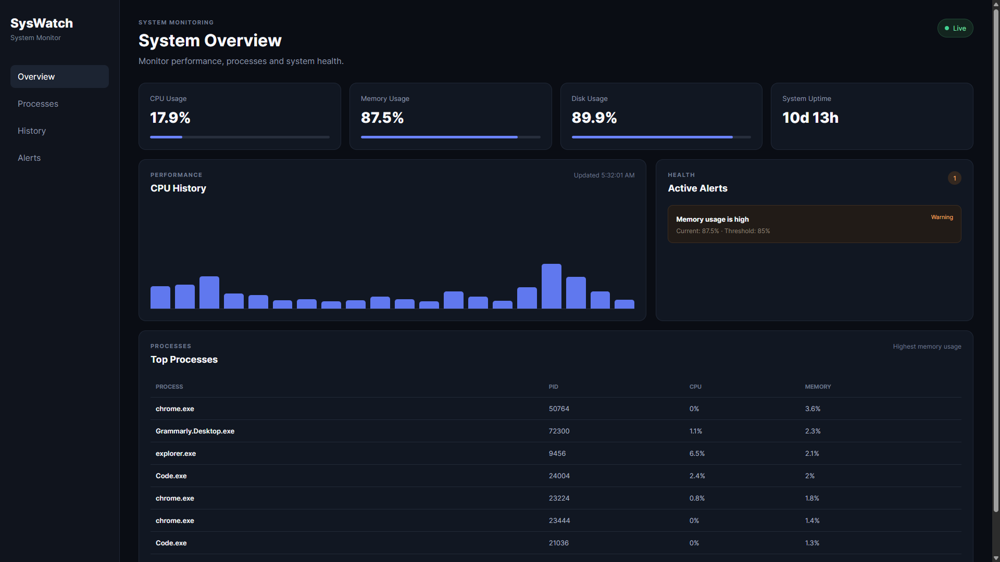

# SysWatch

SysWatch is a real-time system monitoring dashboard that tracks computer performance, running processes, metric history, and system health alerts.

The application uses a FastAPI backend to collect system information and a React frontend to display live metrics in a responsive dashboard.



## Features

- Real-time CPU usage monitoring
- Memory usage and capacity tracking
- Disk usage monitoring
- System uptime
- Running process monitoring
- Top processes by resource usage
- CPU usage history
- SQLite metric history storage
- Automatic system health alerts
- Configurable API query limits
- Automatic dashboard refresh every 5 seconds
- Responsive monitoring dashboard
- REST API for system information
- Automated backend tests

## Tech Stack

### Frontend
- React
- Vite
- JavaScript
- CSS

### Backend
- Python
- FastAPI
- psutil
- Uvicorn

### Storage
- SQLite

### Testing
- pytest
- FastAPI TestClient

## Architecture

```text
Operating System
      |
      v
psutil monitoring
      |
      v
FastAPI REST API
      |
      +----> SQLite metric history
      |
      v
React dashboard
```

The FastAPI backend collects system metrics using `psutil`. Recent CPU, memory, and disk measurements are stored in SQLite. The React frontend requests the latest information from the REST API and refreshes the dashboard automatically.

## API Endpoints

| Method | Endpoint | Description |
| --- | --- | --- |
| GET | `/api/status` | Check backend status |
| GET | `/api/system` | Get current CPU, memory, disk, and uptime metrics |
| GET | `/api/processes` | Get running processes |
| GET | `/api/processes?limit=5` | Limit the number of returned processes |
| GET | `/api/history` | Get recent system metric history |
| GET | `/api/history?limit=20` | Limit the number of history records |
| GET | `/api/alerts` | Get active system health alerts |

## Alerts

SysWatch generates warnings when:

- CPU usage reaches 90%
- Memory usage reaches 85%
- Disk usage reaches 90%

## Running Locally

### Requirements
- Python 3
- Node.js
- npm

### Backend

Install dependencies:

```bash
pip install -r backend/requirements.txt
```

Start the backend:

```bash
cd backend
python -m uvicorn app.main:app --reload
```

Backend: `http://127.0.0.1:8000`

API docs: `http://127.0.0.1:8000/docs`

### Frontend

In another terminal:

```bash
cd frontend
npm install
npm run dev
```

Dashboard: `http://localhost:5173`

## Testing

Run the backend tests:

```bash
cd backend
python -m pytest -q
```

The tests cover backend status, system metric responses, process query validation, and alert generation.

## Production Build

```bash
cd frontend
npm run build
```

## Project Structure

```text
SysWatch/
|-- backend/
|   |-- app/
|   |   |-- alerts.py
|   |   |-- history.py
|   |   |-- main.py
|   |   `-- monitor.py
|   |-- tests/
|   |   `-- test_api.py
|   `-- requirements.txt
|-- frontend/
|   |-- src/
|   |   |-- App.jsx
|   |   |-- App.css
|   |   |-- index.css
|   |   `-- main.jsx
|   `-- package.json
|-- images/
|   `-- syswatch-dashboard.png
`-- README.md
```

## Author

Hetank Patel
